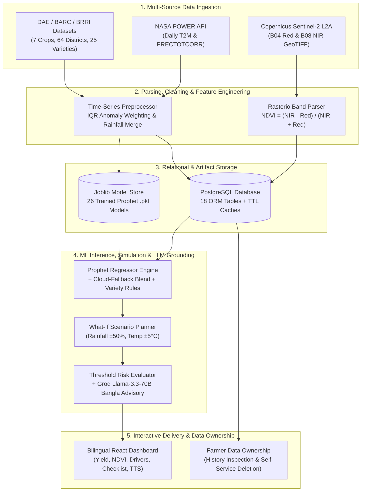

# FieldForesight System Architecture & AI-DLC Documentation

**FieldForesight** is a climate-smart crop yield forecasting, satellite vegetation monitoring, and Bangla AI advisory platform calibrated for all 64 administrative districts and agro-ecological zones of Bangladesh.

---

## 1. Technology Stack & Libraries (`Build Provenance → Frameworks & Libraries`)

### Backend (`Python 3.12+ / FastAPI`)
- **API & Web Framework**: `FastAPI` (`0.115.12`), `Uvicorn` (`0.40.0`), `Starlette`, `Pydantic v2` (`2.12.5`)
- **Database & Admin ORM**: `SQLAlchemy` (`2.0.40`), `PostgreSQL` (`postgresql+psycopg2` with 18 relational tables, pool pre-ping & connection timeouts), `SQLAdmin` (`0.20.1`)
- **Machine Learning & Data Science**: `Prophet` (`1.1.6`), `scikit-learn` (`1.6.1`), `scipy` (`1.15.2`), `pandas` (`2.2.3`), `numpy` (`2.2.4`), `joblib` (`1.5.0`)
- **Geospatial & Remote Sensing**: `sentinelhub` (`3.11.1`), `rasterio` (`1.4.3`), `matplotlib` (`3.10.1`)
- **LLM Integration**: `Groq Cloud API` (`llama-3.3-70b-versatile`, `llama-3.1-8b-instant` via `requests`), Google `Gemini 2.0 Flash` secondary fallback
- **Security & Auth**: `pwdlib[argon2]` (`0.2.1` Argon2id password hashing), `HTTPBearer` expiring session tokens, Role-Based Access Control (`admin` vs `farmer`)

### Frontend (`React 19 / TypeScript / Vite`)
- **Core UI**: `React` (`19.2.0`), `TypeScript`, `Vite`
- **Styling & Icons**: `Tailwind CSS`, `Lucide React`
- **Routing & State**: `React Router DOM`, `Context API` (`AuthContext`, `LanguageContext` for instant Bangla/English switching)
- **HTTP & Browser APIs**: `Axios` with Bearer token interceptor, Web Speech API (`window.speechSynthesis` for `bn-BD` Bangla audio advisory)

---

## 2. End-to-End Data Flow & 5-Stage Data Lifecycle (`Basics → Data Lifecycle`)



---

## 3. AI Development Lifecycle (`AI-DLC`) Process

1. **Problem Framing & Agronomic Rule Design**:
   - Defined formal agronomic adjustment rules in [`docs/variety_rule.md`](file:///home/tanim_saan/projects/FieldForesight/FieldForesight/docs/variety_rule.md), [`docs/mixed_cropping_rule.md`](file:///home/tanim_saan/projects/FieldForesight/FieldForesight/docs/mixed_cropping_rule.md), and [`docs/cloud_fallback_rule.md`](file:///home/tanim_saan/projects/FieldForesight/FieldForesight/docs/cloud_fallback_rule.md).
2. **Data Curating & Recent-Anomaly Weighting**:
   - Merged 10-year historical district yields with annual NASA POWER rainfall regressors in [`app/services/preprocess_data.py`](file:///home/tanim_saan/projects/FieldForesight/FieldForesight/app/services/preprocess_data.py) and down-weighted extreme climate anomaly years (`is_anomaly` -> `weight = 0.5`).
3. **Model Training, Backtesting & Registry**:
   - Trained 26 crop-district Prophet models with `model.add_regressor("rainfall")` in [`train_model.py`](file:///home/tanim_saan/projects/FieldForesight/FieldForesight/train_model.py).
   - Evaluated each model using historical holdout backtesting (`MAE`, `RMSE`, `MAPE` in [`app/services/model_evaluation.py`](file:///home/tanim_saan/projects/FieldForesight/FieldForesight/app/services/model_evaluation.py)) and registered versions in the `model_metadata` table.
4. **Hybrid Fallback & Guardrailed LLM Synthesis**:
   - Implemented the weighted Cloud-Fallback rule (`(8 - N)/8` regional blend) for sparse districts and coupled quantitative predictions with Groq `llama-3.3-70b-versatile` JSON-mode advisories backed by a deterministic BARC rule engine.
5. **Automated End-to-End Verification**:
   - Verified all 17 database tables, ML pipelines, and 18+ API routes via `unittest` & FastAPI `TestClient` ([`tests/test_backend_comprehensive.py`](file:///home/tanim_saan/projects/FieldForesight/FieldForesight/tests/test_backend_comprehensive.py)).

---

## 4. Deployment Method (`Build Provenance → Deployment`)

### Local / Production Server Deployment
1. **Backend (FastAPI + Uvicorn + PostgreSQL / SQLAlchemy)**:
   ```bash
   python3 -m venv venv
   source venv/bin/activate
   pip install -r requirements.txt
   python -m app.scripts.load_data
   python train_model.py
   uvicorn app.main:app --host 0.0.0.0 --port 8000
   ```
   - On startup, `initialize_database()` in [`app/main.py`](file:///home/tanim_saan/projects/FieldForesight/FieldForesight/app/main.py) automatically creates all 17 tables, seeds reference crops/regions/varieties/thresholds/NDVI cache, and mounts SQLAdmin at `/admin`.
2. **Frontend (Vite + React Production Build)**:
   ```bash
   cd frontend
   npm install
   npm run build
   npm run preview -- --port 4173
   ```

---

## 5. Planned Architecture Extensions (RAG, Token Optimization & MCP)

### 5.1 Contextual RAG + Variable Semantic Chunking (`Planned / Next Phase`)
- **Corpus**: `docs/variety_rule.md`, `docs/mixed_cropping_rule.md`, `docs/cloud_fallback_rule.md`, and BARC/BRRI Fertilizer & Pest Management Handbooks.
- **Chunking & Indexing**: Variable markdown section chunking with prepended Anthropic-style contextual headers (`[Crop | Region | Growth Stage | Source]`) indexed via `scikit-learn` TF-IDF / dense vector embeddings to ground Groq advisories with exact handbook citations.

### 5.2 Token Optimization Pipeline (`Planned / Next Phase`)
- **Pre-Inference Compression**: Context pruning and token-budget estimation before dispatching requests to Groq, paired with semantic cache lookup in `AdvisoryHistory` and `ExplainabilityCache`.

### 5.3 Model Context Protocol (`MCP`) Server (`Planned / Next Phase`)
- **MCP Tools Exposed**: `predict_crop_yield`, `get_district_ndvi`, `simulate_climate_scenario`, and `generate_bangla_advisory` over `stdio` and FastAPI `/api/mcp` SSE transport so external AI agents and IDEs can query FieldForesight telemetry directly.

