# FieldForesight RAG Architecture & Frontend Builders Specification

This document details the **Retrieval-Augmented Generation (RAG)** architecture, chunking pipelines, contextual embeddings, guardrails, and **Frontend Visual AI Builder** provenance implemented in **FieldForesight**.

---

## 1. RAG End-to-End Pipeline & Architecture

```mermaid
flowchart TD
    subgraph KnowledgeIngestion["1. Knowledge Ingestion & Indexing Pipeline"]
        MD["Official Agronomic Markdown\n(BRRI, BARI, BJRI Guidelines)"]
        Frontmatter["YAML Frontmatter Parser\n(crop, source, topic)"]
        H_Split["Heading-Based Semantic Segmentation\n(# and ## markdown sections)"]
        Danda_Split["Bangla Sentence Tokenizer\n(Splits on danda '।' and punctuation)"]
        Semantic_Chunk["Variable Semantic Chunking\n(Adjacent sentence cosine similarity < 0.75\nMin 60 chars, Max 450 tokens, 1-sentence overlap)"]
        Contextual_Header["Anthropic-Style Contextual Header\n('Document: <title> | Section: <heading> | Crop: <crop>')"]
        Embed_Passage["e5 Passage Prefixing & Normalization\n('passage: <header + text>', L2 normalized)"]
        Chroma["ChromaDB Persistent Collection\n('knowledge', Cosine Metric)"]

        MD --> Frontmatter --> H_Split --> Danda_Split --> Semantic_Chunk --> Contextual_Header --> Embed_Passage --> Chroma
    end

    subgraph QueryPipeline["2. Real-Time Query & Guardrail Pipeline"]
        Farmer["Farmer Query (Bangla/English)\n+ Active Context (Crop, Region, Yield)"]
        Scope_Check{"Scope Guardrail Check\n(Agri/Platform Domain?)"}
        Decline["Polite Out-of-Domain Response\n('এটা আমার কাজের বাইরে...')"]
        
        Embed_Query["e5 Query Prefixing\n('query: <user message>')"]
        Vector_Search["ChromaDB Vector Retrieval\n(Crop Metadata Filter + Top-K Cosine Search)"]
        Pesticide_Check{"Pesticide / Chemical\nDosage Query?"}
        Enforce_Safety["Strict Dosage Guardrail\n(Enforce SAAO / DAE 16123 Advisory)"]
        LLM["Groq Llama-3.3-70b / Local Fallback\n(Language Mirroring + Grounded Context)"]
        UI["Floating ChatWidget & ChatPanel UI\n(Bangla Response + Verified Source Attribution)"]

        Farmer --> Scope_Check
        Scope_Check -- "Out of Scope" --> Decline
        Scope_Check -- "In Scope" --> Embed_Query --> Vector_Search --> Pesticide_Check
        Pesticide_Check -- "Chemical Dosage" --> Enforce_Safety --> LLM
        Pesticide_Check -- "General Agri" --> LLM
        LLM --> UI
    end
```



---

## 2. Corpus Provenance & Sourcing

All knowledge guidelines are sourced from authentic national agricultural research institutions in Bangladesh:
- **BRRI (Bangladesh Rice Research Institute)**: Rice cultivation, AWD irrigation, blast control, and regional variety suitability.
- **BARI (Bangladesh Agricultural Research Institute)**: Potato (late blight), Wheat (heat tolerance, blast), Maize (fall armyworm), Mustard (aphid management), and Lentil (stemphylium blight).
- **BJRI (Bangladesh Jute Research Institute)**: Jute retting (ribbon retting), weed management, and fiber extraction.

Files are organized in `docs/knowledge/*.md` with explicit YAML frontmatter:
```yaml
---
crop: Potato
source: Bangladesh Agricultural Research Institute (BARI) - Tuber Crops Research Centre
topic: আলু উৎপাদন প্রযুক্তি, সেচ ও নাবি ধসা (Late Blight) ব্যবস্থাপনা
---
```

---

## 3. Embedding Model & Representations

- **Model**: `intfloat/multilingual-e5-small` (384-dimensional dense vectors).
- **Bangla Support**: Fully validated multilingual transformer with native Bengali and English agronomic tokenization.
- **Asymmetric Prefixing**:
  - Documents: `passage: <header + text>`
  - Queries: `query: <user question>`
- **Normalization**: All embeddings are $L_2$-normalized (`normalize_embeddings=True`), ensuring cosine distance in ChromaDB maps directly to inner product:
  $$\text{cosine\_similarity} = 1.0 - \text{distance}$$
- **Lifecycle**: Lazy-loaded singleton in memory (`app/services/rag_service.py`), loaded once on startup without per-request latency.

---

## 4. Variable / Semantic Chunking Algorithm

Rather than arbitrary fixed-character splitting that breaks agricultural recommendations mid-sentence, FieldForesight employs a 4-step dynamic chunking algorithm:
1. **Markdown Heading Segmentation**: Splits documents by structural `#` and `##` sections.
2. **Bangla Sentence Boundary Detection**: Handles the Bengali danda (`।`) alongside standard terminators (`.`, `?`, `\n`).
3. **Semantic Boundary Detection**:
   - Embeds adjacent sentences within each section.
   - Computes cosine similarity between consecutive sentences.
   - When topic similarity drops below `RAG_SEMANTIC_THRESHOLD = 0.75`, a new chunk boundary is triggered.
4. **Boundary & Size Constraints**:
   - Minimum chunk size: 60 characters (merges tiny sentence fragments).
   - Maximum chunk size: 450 tokens.
   - Context overlap: 1 sentence overlap between adjacent chunks.

---

## 5. Contextual RAG (Anthropic-Style)

To prevent standalone chunks from losing global document context during isolated vector matching:
- Every chunk is prepended with a contextual header **before embedding**:
  ```
  Document: <Title> | Section: <Heading> | Crop: <Crop>
  ```
- **Dual Representation**:
  - **Indexed Text**: Contextual header + chunk content (embedded for vector retrieval).
  - **Stored Metadata**: The original clean passage, title, and section.
- **Inference**: ChromaDB searches the context-rich vector space, but returns the clean original text and citation headers to the LLM and user interface.

---

## 6. ChromaDB Persistent Vector Store

- **Client Location**: Local embedded instance at `app/data/chroma/` (cosine distance collection `"knowledge"`).
- **Metadata Filtering**: When a farmer has an active crop selected on their dashboard, retrieval applies an exact metadata filter:
  ```python
  where={"crop": crop.lower()}
  ```
- **Similarity Thresholding**: Results with cosine similarity below `0.80` are rejected to prevent hallucinating answers from unrelated agricultural text.

---

## 7. Strict Safety Guardrails & Pesticide Enforcement

Because incorrect pesticide or fertilizer advice directly threatens crop yield and farmer livelihood:
1. **Scope Checking**: Queries outside agriculture and platform functionality are politely declined:
   *"এটা আমার কাজের বাইরে। আমি শুধুমাত্র কৃষি এবং FieldForesight সম্পর্কিত বিষয়ে সাহায্য করতে পারি।"*
2. **Pesticide / Chemical Dosage Safeguard**:
   - The chatbot is explicitly forbidden from hallucinating or inventing numeric chemical dosages.
   - Any question regarding chemical pesticide applications mandates redirecting the farmer to their local Sub-Assistant Agriculture Officer (SAAO / উপ-সহকারী কৃষি কর্মকর্তা) or the national **DAE Krishi Call Center (16123)**.
3. **Language Mirroring**: Automatically matches the user's language (pure Bangla, English, or Banglish).
4. **Transparent Source Chips**: Assistant responses render clickable citation chips showing the exact research institute and document section.

---

## 8. Frontend AI & Visual Builders Usage

The frontend of FieldForesight (`React 19 + TypeScript + Vite + Tailwind CSS`) was accelerated using visual AI builders and prompt prototyping tools:

| Builder / Tool | Role & Contribution | Key Components Generated / Refined |
| :--- | :--- | :--- |
| **Lovable** | Full UI component scaffolding & Tailwind styling | Scaffolded core layout shells, card designs, color harmonies (forest green `#004741`, amber accents), and mobile responsiveness. |
| **Stitch (Google Stitch / UI Builder)** | Visual component design & spacing alignment | Engineered the sliding drawer interaction for `ChatWidget.tsx` and `ChatPanel.tsx`, responsive breakpoints, and badge positioning. |
| **Google AI Studio** | Prompt engineering & schema validation | Prototyped the multilingual agronomic system prompts, tested boundary edge-cases (pesticide safety rules, Banglish inputs), and validated JSON schema contracts for FastAPI. |

### Visual Builder Notes for Evaluation Sheet:
- **Tools Used**: Lovable, Stitch, Google AI Studio.
- **Workflow**: Google AI Studio was used to design and stress-test the structured system instructions and safety guardrails. Lovable and Stitch generated the production React component layout, mobile-first responsive sliding drawers, and Tailwind theme tokens, which were then wired into custom React Contexts (`ChatContext.tsx`, `LanguageContext.tsx`, `AuthContext.tsx`).

